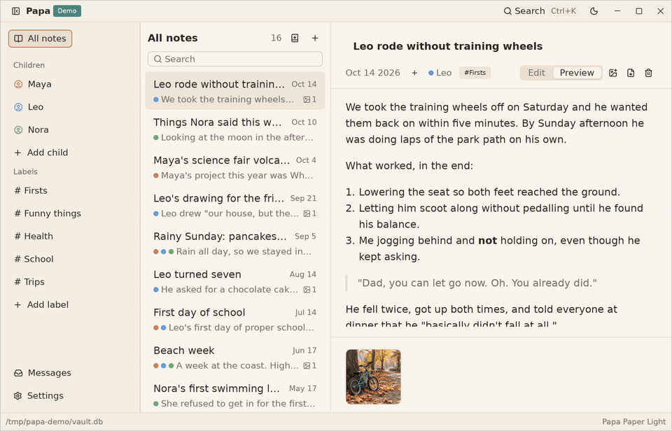
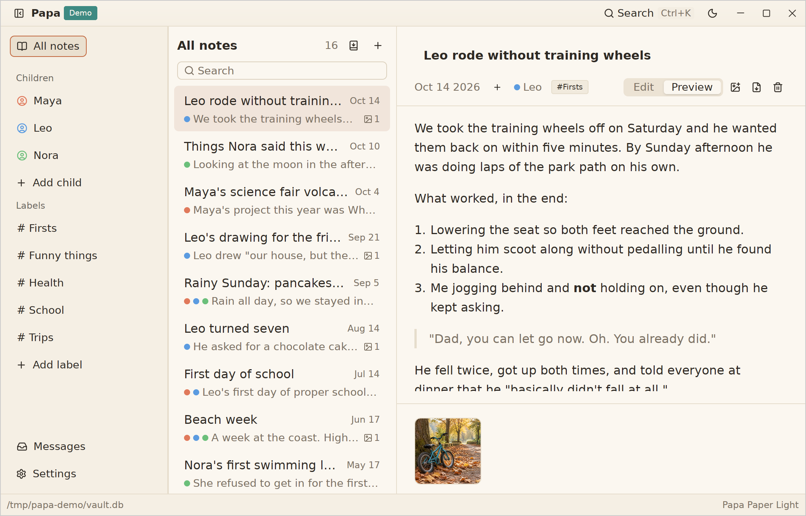
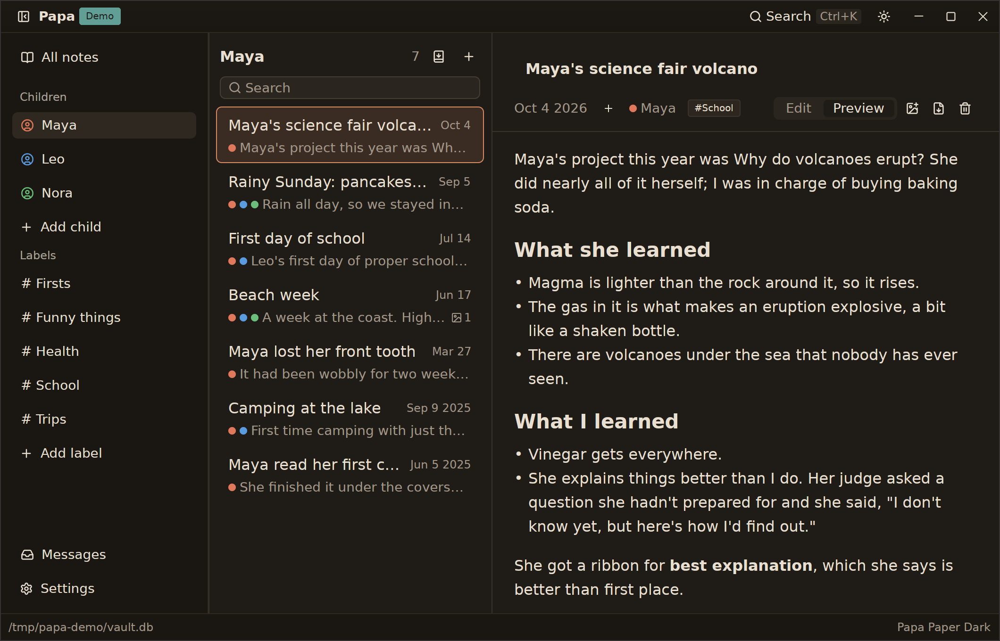
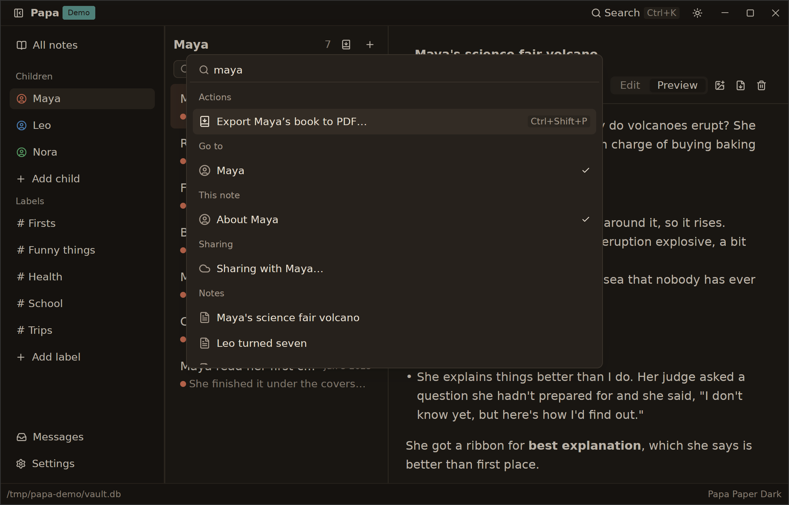
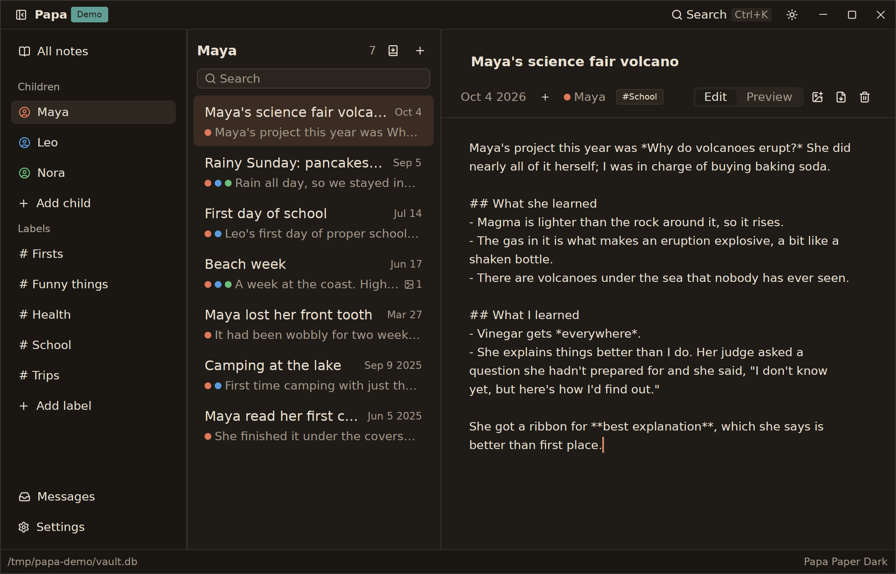
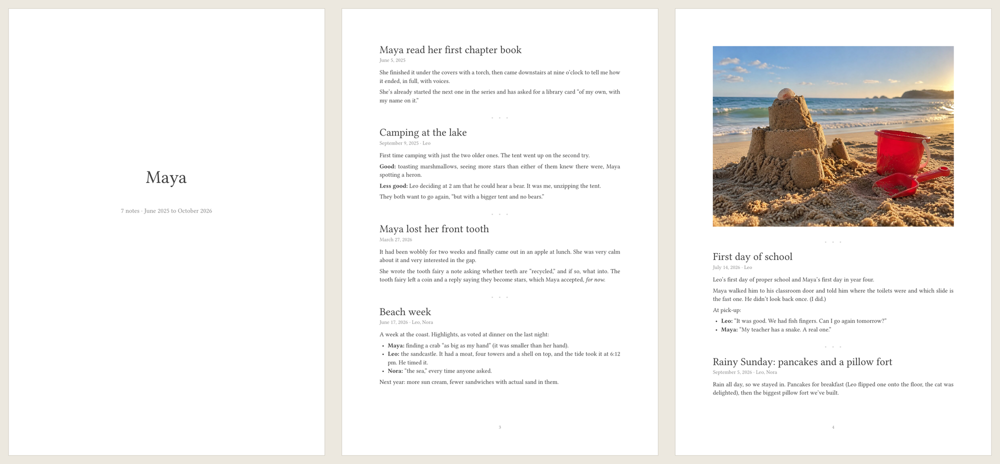

# Papa

[](https://github.com/papadavis47/papa/actions/workflows/ci.yml)
[](#license)

A private, local-first journal for fathers. Keep a profile for each of your children, write notes and save photos about them, and, if you choose, share some of those notes with a child, who can read them in the same app, export them to PDF and message you back.

Built in Rust with [GPUI](https://www.gpui.rs), the GPU-accelerated UI framework behind the Zed editor, and [Turso](https://turso.tech) for local storage and sync.



<sub>The tour as an [MP4](docs/media/tour.mp4). Everything shown is the demo's invented family (`papa --demo`), not real data.</sub>

> **Status:** early development, built in public. Phases 0–14 (workspace and CI, app shell, local storage, notes, images, settings and themes, command palette, Vim mode, PDF export, vault lock and backup, the relay server, sharing notes from the father's side, child mode for reading them, messages between father and child, and installable packages for Linux, macOS and Windows) are done. See [PLAN.md](PLAN.md) for the roadmap.

## Try it

With a [Rust toolchain](https://rustup.rs) and the [system libraries](#building) installed:

```sh
git clone https://github.com/papadavis47/papa.git
cd papa
cargo run --release -- --demo
```

`--demo` opens a vault made up for the occasion: three children, sixteen notes over three years, a few photos. It's rebuilt from scratch every time and lives in your temporary folder, so your own vault and settings are never touched. Try ⌘K (Ctrl+K on Linux and Windows) to find anything, ⌘N for a new note, ⌘E to switch between Markdown and preview, ⌘⇧P to export a child's book to PDF, and ⌘⇧L for the dark theme.

## Screenshots

| | |
|---|---|
|  |  |
| **All notes.** Children and labels in the sidebar, the notes in a virtualized list, the open note rendered from Markdown with its photos. | **One child's notes**, in the dark theme. |
|  |  |
| **The ⌘K palette** reaches every command, child, label and note. | **Notes are Markdown**, written in Papa's editor (with an optional Vim mode). |



<p align="center"><sub><strong>A child's book as a PDF</strong>, typeset in-process with Typst: title page, contents, then every note about them, oldest first, with photos.</sub></p>

## Features

- **Profiles for each child**, notes in Markdown with photos, your own labels, and notes about one child or several
- **Local-first:** the vault is a [Turso](https://turso.tech) database on your computer and works fully offline
- **Optional end-to-end encrypted sharing:** each child sees **only** the notes shared with them, in the same app, and can read them offline
- **Messages** between father and child, with read receipts
- **PDF export:** one note, the notes a label or search picks out, or a child's whole book with a title page and contents, typeset with [Typst](https://typst.app)
- **Privacy:** an optional password encrypts the vault on disk, with auto-lock and one-file backups
- **Keyboard first:** a ⌘K command palette, shortcuts for every pane, and an optional Vim mode (Normal, Insert and Visual modes, counts and operators, `:w`)
- **Themes** with light and dark variants, your own theme files (reloaded as you edit them), and settings for fonts, text size and density
- **Installable** on Linux (`.deb`, AppImage), macOS (`.dmg`) and Windows (installer, MSI)

## How it's built

```
┌─ papa (desktop app) ─────────────┐        ┌─ papa-relay (server) ────────┐
│ GPUI views via gpui-kit          │ HTTPS  │ axum: accounts, invites,     │
│ actions · key contexts · Vim     │───────▶│ one database per child,      │
├──────────────────────────────────┤        │ one-hour scoped tokens       │
│ papa-core                        │        └──────────────────────────────┘
│ Store: Turso vault on its own    │
│ thread · crypto · share sync     │  turso sync   ┌─ share database ─────────┐
│ papa-pdf: Markdown → Typst → PDF │──────────────▶│ per child, ciphertext    │
└──────────────────────────────────┘               └──────────────────────────┘
```

- **Rust** (edition 2024) in a Cargo workspace of five crates. Only the app crate knows about the UI; storage, crypto and sync live in `papa-core`, which is tested without a window.
- **[GPUI](https://www.gpui.rs)** via **[gpui-kit](https://gpui-kit.com)** for the interface: entities and components, actions bound to keys, and a headless test window for UI tests.
- **[Turso](https://turso.tech)**, the Rust rewrite of SQLite, for the vault (with encryption at rest) and for syncing each child's share database.
- **[Typst](https://typst.app)**, run as a library, for PDFs.
- **Cryptography:** Argon2id, HKDF and XChaCha20-Poly1305 from the RustCrypto crates. The server only ever stores ciphertext.

More detail: [docs/architecture.md](docs/architecture.md) (crates, threading, storage, sharing and the security model) and the [decision records](docs/adr/), which say *why* each big choice was made.

### Technical highlights

What the [phases in PLAN.md](PLAN.md#8-phases--one-step-at-a-time) put into practice:

- **Rust itself:** ownership across threads (a database actor behind a cloneable channel handle), `async` with two executors (GPUI's and tokio's), errors with `thiserror` and `anyhow`, enums that make wrong states unrepresentable (father mode and child mode are separate types), and test-driven state machines (the Vim parser).
- **GPUI:** entities vs. components, subscriptions and events, actions and key contexts, background tasks, virtualized lists, animation, and testing views in a headless window.
- **Turso:** an embedded database with migrations, encryption at rest, the Platform API for a database per tenant, and offline-first replicas that push and pull.
- **Security:** deriving keys from passwords and access keys, authenticated encryption bound to where each row belongs, and a sync design that's safe to repeat.
- **Shipping:** a small axum server, CI on Linux and macOS, cross-platform packages, and keeping a public repository free of secrets and real family data.

## Repository layout

```
crates/
├── papa/        desktop app (the only crate that depends on gpui-kit)
├── papa-core/   domain logic: models, Turso storage, crypto, sharing, the demo vault
├── papa-proto/  API types shared by the app and the relay
├── papa-pdf/    Markdown → PDF export
└── papa-relay/  small server: accounts, invites, scoped tokens
docs/
├── architecture.md
├── adr/         architecture decision records
└── media/       the screenshots and tour above
```

## Building

You need a recent stable Rust toolchain ([rustup](https://rustup.rs)).

**Linux** also needs the native libraries GPUI links against (Debian/Ubuntu names):

```sh
sudo apt install build-essential pkg-config libfontconfig-dev libfreetype-dev \
  libwayland-dev libxkbcommon-dev libxkbcommon-x11-dev libx11-xcb-dev libvulkan-dev
```

**macOS** needs the Xcode command line tools (`xcode-select --install`).

Then:

```sh
cargo run                       # run the desktop app
cargo test --workspace          # run all tests
cargo clippy --workspace --all-targets -- -D warnings
cargo fmt --all
```

### Running the demo in development

The [demo](#try-it) runs from a normal debug build. Everything after `--` goes to Papa rather than to Cargo:

```sh
cargo run -- --demo             # debug build: quick to compile
cargo run --release -- --demo   # optimised: slower to build, smoother to use
./target/debug/papa --demo      # the binary the first command built, without Cargo
cargo run -- --help             # Papa's options
```

Each run deletes the last demo and builds a new one in `papa-demo` in your temporary folder (`/tmp/papa-demo` on Linux, under `$TMPDIR` on macOS). Its settings live there too, so switching themes or turning on Vim mode in the demo doesn't change your own. To start over, quit and run it again. Its tests, and the command line's:

```sh
cargo test -p papa-core demo
cargo test -p papa cli
```

The sample notes are in [`crates/papa-core/src/demo.rs`](crates/papa-core/src/demo.rs) and their photos in `crates/papa-core/demo/`. Edit either and the next `cargo run -- --demo` uses them.

### Your own vault in development

The app keeps its vault in your OS data directory (`~/.local/share/papa/vault.db` on Linux, `~/Library/Application Support/papa/vault.db` on macOS). To try things out without touching it, point `PAPA_VAULT` at another file:

```sh
PAPA_VAULT=/tmp/papa-dev.db cargo run
```

Settings live apart from the vault, in `~/.config/papa/settings.json` on Linux and `~/Library/Application Support/papa/settings.json` on macOS, with your own theme files in a `themes` folder next to it. `PAPA_CONFIG_DIR` points both somewhere else:

```sh
PAPA_VAULT=/tmp/papa-dev.db PAPA_CONFIG_DIR=/tmp/papa-dev-config cargo run
```

### Installable packages

There are no releases yet. When there are, they'll be on the [releases page](https://github.com/papadavis47/papa/releases): a `.deb` and an AppImage for Linux, a `.dmg` for macOS on Apple silicon, and an installer and an MSI for Windows. To build them yourself, install [cargo-packager](https://github.com/crabnebula-dev/cargo-packager) and run, on the system you're packaging for:

```sh
cargo install cargo-packager --version 0.11.8 --locked
cargo packager -p papa --profile dist --formats deb,appimage   # Linux
cargo packager -p papa --profile dist --formats app,dmg        # macOS
cargo packager -p papa --profile dist --formats nsis,wix       # Windows
```

It builds Papa with the `dist` profile (smaller and faster than `--release`, but slower to build), then writes the packages to `target/packages/`. The macOS app is signed ad hoc, not with an Apple Developer ID, so macOS won't open a downloaded copy at first: open it once, then choose **Open Anyway** in System Settings → Privacy & Security. The Windows installers aren't signed either, so SmartScreen asks first. Pushing a `v*` tag builds all of them in CI and attaches them to a draft GitHub release ([release.yml](.github/workflows/release.yml), [ADR 0018](docs/adr/0018-packaging-with-cargo-packager.md)).

### The relay server

`papa-relay` handles accounts, invites and access to shared notes. For development it runs against Turso's local sync server, so no cloud account is needed. You need the `tursodb` CLI ([Turso releases](https://github.com/tursodatabase/turso/releases), v0.8.2):

```sh
mkdir -p dev-sync   # tursodb won't create it
tursodb --sync-server 127.0.0.1:8080 --sync-dir dev-sync
PAPA_RELAY_LOCAL_SYNC_DIR=dev-sync cargo run -p papa-relay
cargo run -p papa-relay -- admin invite create "Me"   # in another terminal
```

Its settings are environment variables, listed in [.env.example](.env.example).

### Sharing notes (father's side)

With `tursodb` and the relay running as above, start the app, then:

1. **Sign in.** ⌘K → "Sign in to Papa…", or Settings → Sharing. The server is `http://127.0.0.1:8787` by default; "Create account…" takes the invite code from `admin invite create`.
2. **Turn sharing on for a child.** Right-click them in the sidebar → Sharing… → Start sharing (or ⌘K → "Sharing with Emma…"). The dialog shows the child's access key, `PAPA-XXXX-…`, to copy, replace or revoke.
3. **Share a note.** Open a note about that child, then tick "Emma can read it" under the + next to its date (or ⌘K → "Emma can read it").

Papa encrypts the shared notes on your computer, writes them to `shares/<child>.db` next to the vault, and pushes them a few seconds after each change. The status bar shows the last sync.

### Reading shared notes (child's side)

A child uses the same app. On a computer with no vault, Papa asks what you'd like to do; to try it next to your own vault, give it another folder:

```sh
PAPA_VAULT=/tmp/papa-child/vault.db cargo run
```

Choose "Open notes shared with me", type Dad's email and paste the key from his sharing dialog. Papa downloads the share to `child/share.db` next to where the vault would be, decrypts it, and shows the notes read-only. ⌘R checks for new ones (it also does every 30 seconds), ⌘P and ⌘⇧P export to PDF, and the notes stay readable offline. If Dad makes a new key, the app says the old one stopped working and asks for the new one.

### Messages

Dad and a child he shares with can write to each other. In Dad's app, Messages is at the foot of the sidebar (⌘⇧M, or ⌘K → "Write to Emma"); in the child's, it's next to Notes from Dad. Both apps check for new messages every 30 seconds and send at once. A message written offline says "Sending…" and goes with the next check. Messages are encrypted like notes, and Dad's vault keeps the conversation even if sharing stops.

Some tests start `tursodb` to sync for real. They look for it on the `PATH` (or in `$TURSODB`) and skip when it's missing; CI installs it and sets `PAPA_REQUIRE_TURSODB=1`, so there they can't skip.

## Privacy

Real vaults live in your operating system's app-data directory, never in this repository. A vault can be locked with a password, which encrypts it on disk (Settings → Privacy); without the password the file is unreadable, and a forgotten password can't be recovered. Settings → Data → Back up saves the whole vault as one file to keep elsewhere. Anything shared through the cloud is encrypted on your device first, so the server only ever stores ciphertext: never a note's text, its labels, or which children it's about. Screenshots, the tour and test data use invented children and notes: the screenshots come from `papa --demo`, and its photos are illustrations made for it.

## License

Licensed under either of

- Apache License, Version 2.0 ([LICENSE-APACHE](LICENSE-APACHE))
- MIT license ([LICENSE-MIT](LICENSE-MIT))

at your option.
